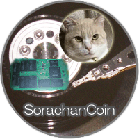

Welcome to SORA Blockchain - Core, Quantum Resistance ML-DSA FIPS204 (NIST standard) supported. 
A hybrid scrypt PoW/PoS based cryptocurrency.

What is SORA L1 L2 Blockchain?
===========================
SORA L1 Blockchain - Core wallet official sites: 
https://www.junkhdd.com/ 
https://sora.junkhdd.com/ 
https://de.junkhdd.com/ 
https://us.junkhdd.com/

SORA L2 Blockchain - FromHDDtoSSD wallet official sites: 
Supported HDD/SSD/NVMe drive inspection by SORA Blockchain 
https://www.iuec.co.jp/fromhddtossd2s/v3_0_dl.html 
https://www.fromhddtossd.com/

Bitcointalk: 
https://bitcointalk.org/index.php?topic=5184483

Discord: 
https://discord.gg/ThMeemM

X: 
https://x.com/DataRescueCoin

How to build?
===========================
chmod +x sora_builder.sh autogen.sh 
./sora_builder.sh 
generated under ./src, "soracoind" "soracoin-cli"

Development tools necessary for building
===========================
AlmaLinux 
dnf groupinstall "Development Tools" 
dnf install git 
dnf install wget

Ubuntu / Debian 
sudo apt install build-essential 
sudo apt install git 
sudo apt install zlib1g-dev 
sudo apt install autoconf automake

soracoin-cli
===========================
e.g. using -datadir 
soracoin-cli -datadir=/coins/sora getinfo

e.g. using -testnet 
soracoin-cli -testnet getinfo

Block Explorer
===========================
https://us.junkhdd.com:7350/ 
https://de.junkhdd.com:7350 
https://www.junkhdd.com:7350/
